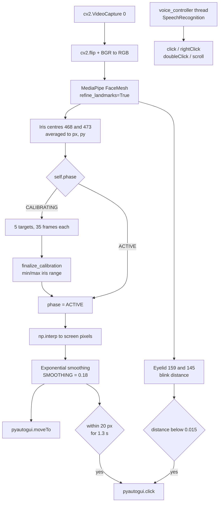

<div align="center">

# 👁️ Nexus Neural Link

<strong>A webcam-only, hands-free desktop controller: look where you want the cursor to go, hold for 1.3 seconds, and it clicks.</strong>

[](https://github.com/Manav57/-Multimodal-Human-Computer-Interaction-System-Using-Eye-Tracking-and-Voice-Commands)
[](https://www.python.org/)
[](https://developers.google.com/mediapipe)
[](https://github.com/TomSchimansky/CustomTkinter)
[](#-contributing)

</div>

<hr>

<div align="center">

[Overview](#-overview) · [Features](#-features) · [Architecture](#-architecture) · [Commands](#-gesture--command-reference) · [Tech Stack](#-tech-stack) · [Quick Start](#-quick-start) · [Limitations](#-known-limitations)

</div>

## 🎯 Overview

Nexus Neural Link turns an ordinary webcam into a gaze input device. It reads the iris mesh from MediaPipe Face Mesh, maps pupil movement onto the full desktop, and adds two independent selection paths: a deliberate blink, or a dwell (stare at the same spot for 1.3 s). A second thread listens for spoken commands so right-click, double-click, and scrolling never require a hand.

The project exists for the cases where a mouse is the wrong tool: **motor-impairment accessibility**, RSI and repetitive-strain avoidance, sterile or shared kiosk screens, and hands-busy work at a bench. It deliberately avoids IR eye-tracker hardware — everything runs from the camera and microphone already built into a laptop.

**Who it is for**

- Accessibility engineers and advocates prototyping alternative input with commodity hardware.
- HCI students who want a readable, end-to-end gaze pipeline instead of a paper.
- Developers curious about MediaPipe iris landmarks 468 and 473 in practice.

## ✨ Features

- **Iris-mesh cursor, no extra hardware.** `FaceMesh(refine_landmarks=True, min_detection_confidence=0.9)` exposes the refined iris points; the cursor is driven by the average of landmark `468` and `473`, so both eyes contribute and single-eye jitter is averaged down.
- **Five-point calibration.** `self.targets` places dots at all four corners (inset 150 px) plus screen centre. While calibrating, each frame appends `{'iris': (px, py), 'screen': (tx, ty)}`, and the target advances every 35 frames — roughly a second of looking per dot at webcam frame rates.
- **Min/max range mapping.** `finalize_calibration()` computes `np.min` / `np.max` over every collected iris sample, then `np.interp` stretches that observed range across the full desktop width and height.
- **Exponential smoothing.** `SMOOTHING = 0.18` blends each new target with the previous cursor position, trading a little lag for a cursor that does not vibrate.
- **Blink to click.** `get_blink_dist()` measures the vertical gap between eyelid landmarks `159` and `145`; a value below `BLINK_THRESH = 0.015` fires `pyautogui.click()`, followed by a `0.3` s sleep to prevent repeat clicks.
- **Dwell to click.** If the smoothed cursor stays within **20 px** of its last anchor for longer than `DWELL_TIME = 1.3` s, it clicks and resets the timer.
- **Multimodal voice layer.** A daemon `voice_controller()` thread runs `SpeechRecognition` alongside the tracker for left click, right click, double click, and scroll up/down.
- **Fullscreen calibration UI.** A black CustomTkinter canvas with `#007AFF` targets, a "NEXUS EYE CONTROL" start screen, and a single **INITIALIZE EYE TRACKING** button.
- **Three-phase state machine.** `self.phase` moves `START` → `CALIBRATING` → `ACTIVE`, so calibration and live tracking are separate code paths fed by the same frame loop.

## 🧱 Architecture



**One class, six methods — `eye tracking/main.py`**

| Method | Responsibility |
| :--- | :--- |
| `__init__` | Builds the fullscreen `ctk.CTk` window, sets `phase = "START"`, opens `cv2.VideoCapture(0)`, spawns the voice thread, enters `main_loop()`. |
| `main_loop()` | Grabs one frame, mirrors it, converts to RGB, runs Face Mesh, and re-schedules itself with `self.after(10, ...)`. |
| `run_calibration_ui()` | Draws the current target and accumulates iris samples until the 35-frame quota is met. |
| `finalize_calibration()` | Derives the iris bounding box that becomes the cursor's coordinate space. |
| `run_tracking()` | Maps, smooths, moves the cursor, then evaluates blink and dwell clicks. |
| `voice_controller()` | Independent loop over `sr.Microphone()` with `phrase_time_limit=1.5`, dispatching `pyautogui` actions. |

The UI and the tracker share one process: the Tk canvas is the entire screen, and PyAutoGUI moves the real OS cursor underneath it.

## 🎮 Gesture / Command Reference

Every row below maps to a literal condition in `eye tracking/main.py`.

| Input | Condition in code | Result |
| :--- | :--- | :--- |
| **Gaze + hold** | `dist < 20` and `time.time() - self.dwell_start > DWELL_TIME` (`1.3`) | `pyautogui.click()` at the current cursor position, then the dwell timer resets. |
| **Deliberate blink** | `self.get_blink_dist(mesh) < BLINK_THRESH` (`0.015`) | `pyautogui.click()`, then `time.sleep(0.3)`. |
| **Say "left"** or **"select"** | `"left" in cmd or "select" in cmd` | `pyautogui.click()`. |
| **Say "right"** | `"right" in cmd` | `pyautogui.rightClick()`. |
| **Say "double"** | `"double" in cmd` | `pyautogui.doubleClick()`. |
| **Say "scroll up"** (or anything containing "up") | `"scroll up" in cmd or "up" in cmd` | `pyautogui.scroll(SCROLL_SPEED)` → `+300`. |
| **Say "scroll down"** (or anything containing "down") | `"scroll down" in cmd or "down" in cmd` | `pyautogui.scroll(-SCROLL_SPEED)` → `-300`. |
| **Look at each calibration dot** | `len(self.calib_points) > (self.target_idx + 1) * 35` | Collects samples, advances to the next of 5 targets, then activates tracking. |

Two behaviours worth knowing before you try it:

- Voice matching is **substring-based**, not exact phrase. "Bright" contains "right"; "download" contains "down".
- Blink and dwell are independent checks, so a blink that lands while the dwell timer is nearly expired can produce two clicks in quick succession.

## 🧰 Tech Stack

There is **no `requirements.txt`** in this repository. The list below is derived from the imports at the top of `main.py` and the pip package each one resolves to.

| Import | pip package | Role |
| :--- | :--- | :--- |
| `cv2` | `opencv-python` | Webcam capture, mirroring, colour conversion. |
| `mediapipe` | `mediapipe` | Face Mesh with refined iris landmarks. |
| `pyautogui` | `pyautogui` | Cursor movement, clicks, scrolling. |
| `numpy` | `numpy` | `np.interp`, `np.linalg.norm`, min/max range. |
| `customtkinter` | `customtkinter` | Fullscreen overlay window and button. |
| `speech_recognition` | `SpeechRecognition` (+ `pyaudio`) | Microphone capture and Google transcription. |
| `PIL` (`Image`, `ImageTk`) | `Pillow` | Imported at module level; not referenced in the current logic. |
| `tkinter` | Python standard library | Underlying toolkit for CustomTkinter. |

## 🚀 Quick Start

**1. Clone (the folder name starts with a dash — keep the quotes) and create a venv**

```powershell
git clone https://github.com/Manav57/-Multimodal-Human-Computer-Interaction-System-Using-Eye-Tracking-and-Voice-Commands.git
cd "-Multimodal-Human-Computer-Interaction-System-Using-Eye-Tracking-and-Voice-Commands"

python -m venv .venv
.\.venv\Scripts\Activate.ps1
```

**2. Install the dependencies**

```powershell
pip install opencv-python mediapipe pyautogui numpy customtkinter SpeechRecognition Pillow pyaudio
```

> `pyaudio` is only needed for the voice thread, and it needs a wheel matching your Python version. If it fails to build, install a `.whl` or use Python 3.10/3.11.

**3. Run the real entry point**

```powershell
cd "eye tracking"
python "main.py"
```

**4. Calibrate**

Click **INITIALIZE EYE TRACKING**, then follow the blue dot to all five positions. Look with your eyes and keep your head still. When the fifth target completes, the window clears and gaze control is live.

**5. Control**

Move with your gaze, click with a blink or a 1.3 s dwell, and speak for right-click, double-click, and scrolling.

> There is no camera preview and no quit key. Close the process with `Alt+F4` or from the taskbar.

## 📁 Project Structure

```text
-Multimodal-Human-Computer-Interaction-System-Using-Eye-Tracking-and-Voice-Commands/
├── README.md
└── eye tracking/
    ├── main.py               # Entry point: FaceMesh, calibration, gaze mapping, voice thread
    ├── gaze_calib.json       # Shipped 2x3 gaze transform — not read by main.py
    └── gaze_head_calib.json  # Shipped iris + head transform — not read by main.py
```

## 🚧 Known Limitations

- **Calibration does not survive a restart.** `main.py` imports no `json` module and never reads `gaze_calib.json` or `gaze_head_calib.json`; those files are leftovers from an earlier pipeline. Every launch needs a fresh five-point calibration.
- **No head-pose compensation.** The cursor follows the iris bounding box only. Turning or nodding your head drags the cursor with it; `gaze_head_calib.json` suggests head compensation was planned but it is not implemented.
- **Blink and dwell can double-fire.** Both paths call `pyautogui.click()` independently, with no shared lock.
- **Blink threshold is absolute.** `BLINK_THRESH = 0.015` compares normalised eyelid distance, so it is sensitive to camera distance, resolution, and whether you wear glasses.
- **Smoothing is frame-rate dependent.** `SMOOTHING = 0.18` is a fixed per-frame blend, and `main_loop()` reschedules with `self.after(10, ...)` while the camera delivers far fewer frames — behaviour changes with camera and machine speed.
- **Fullscreen with no escape hatch.** The window is `-fullscreen` with no close button and no key binding; the script also never calls `cap.release()`.
- **The debug preview is never shown.** `draw_debug_grid()` draws pupil circles onto the OpenCV frame, but there is no `cv2.imshow()` anywhere — the drawing is discarded.
- **Voice needs the network and a quiet room.** `recognize_google()` uploads audio; the thread calls `r.listen(source, phrase_time_limit=1.5)` with no `adjust_for_ambient_noise()`, so short phrases and background noise cause misses.
- **One face, one camera.** Only `results.multi_face_landmarks[0]` is used and `cv2.VideoCapture(0)` is hard-coded.
- **PyAutoGUI corner failsafe.** With the default `FAILSAFE = True`, a mapped cursor that reaches the top-left pixel raises `FailSafeException` and aborts tracking for that frame.
- **Legacy MediaPipe API.** `mp.solutions.face_mesh` is the pre-Tasks API. If a fresh install raises `AttributeError: module 'mediapipe' has no attribute 'solutions'`, pin an older release such as `mediapipe==0.10.14`.

## 🤝 Contributing

Useful directions: persist and reload calibration, add head-pose compensation, add a visible quit affordance, and replace the two independent click paths with a single arbitrated selection state.

1. Fork the repository.
2. Branch from `main`: `git checkout -b feature/persist-calibration`.
3. Test with a real webcam and note your camera resolution and lighting in the PR.
4. Open a pull request with before/after behaviour.

<div align="center">

### ⭐ If you find this project useful, consider giving it a star!

[github.com/Manav57/-Multimodal-Human-Computer-Interaction-System-Using-Eye-Tracking-and-Voice-Commands](https://github.com/Manav57/-Multimodal-Human-Computer-Interaction-System-Using-Eye-Tracking-and-Voice-Commands)

</div>
